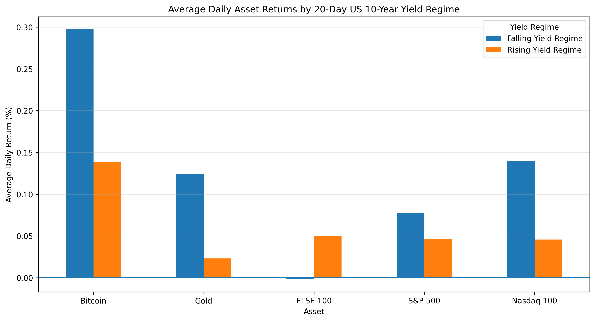

**Python analysis of cross-asset risk, performance and US Treasury yield regimes | 2020–2026**

This project explores how **Bitcoin, Gold, the FTSE 100, S&P 500 and Nasdaq-100** behaved across different market environments, with a particular focus on movements in the **US 10-Year Treasury yield**.

> **Key question:** Do major assets behave differently when Treasury yields are rising versus falling?

### Key Findings

| Finding | Result |
|---|---|
| Highest CAGR | Bitcoin — **44.51%** |
| Lowest maximum drawdown | Gold — **−24.94%** |
| Strongest equity correlation | S&P 500 ↔ Nasdaq-100 — **0.93** |
| Strongest daily yield relationship | Gold |
| Daily yield test | Gold & FTSE 100 significant at **p < 0.001** |
| 20-day regime test | No asset significant at the **5% level** |

The results suggest that the relationship between Treasury yields and asset returns is **not uniform across assets and is sensitive to how the yield environment is defined**.
📓 **[View the full analysis notebook](Market_Regime_Risk_Analysis.ipynb)**
---
## Results

### Risk & Return

| Asset | CAGR | Annualised Volatility | Maximum Drawdown |
|---|---:|---:|---:|
| Bitcoin | 44.51% | 60.68% | -76.63% |
| Gold | 16.17% | 19.34% | -24.94% |
| FTSE 100 | 5.06% | 16.31% | -34.93% |
| S&P 500 | 13.50% | 20.34% | -33.92% |
| Nasdaq-100 | 20.05% | 25.38% | -35.56% |

Bitcoin generated the highest compound growth but also experienced substantially greater volatility and downside risk. Gold produced lower returns but had the smallest maximum drawdown among the assets analysed.
### Cross-Asset Correlation

The **S&P 500 and Nasdaq-100** had the strongest correlation (**0.93**), indicating that the two US equity indices generally moved closely together.

Gold showed much lower correlations with the other assets:

- S&P 500: **0.12**
- Nasdaq-100: **0.13**
- FTSE 100: **0.12**
- Bitcoin: **0.12**

Within this sample, Gold therefore displayed the strongest diversification characteristics among the assets analysed.
### Treasury Yield Regimes

The relationship between asset returns and Treasury yields depended on how the yield environment was defined.

**Daily yield movements**

- Gold averaged **0.315%** on falling-yield days versus **-0.170%** on rising-yield days.
- FTSE 100 averaged **-0.091%** on falling-yield days versus **0.129%** on rising-yield days.
- Both differences were statistically significant using Welch's t-test (**p < 0.001**).
- Bitcoin, S&P 500 and Nasdaq-100 did not show statistically significant differences at the 5% level.

**20-day yield regimes**

When regimes were defined using the change in the US 10-Year Treasury yield over 20 trading days, **none of the five assets showed a statistically significant difference at the 5% level**.

This suggests that the apparent relationship between Treasury yields and asset returns is sensitive to the time horizon used to define the yield environment.

## Research Questions

1. How did the risk and return characteristics of these assets differ over the sample period?
2. How strongly were returns across the asset classes correlated?
3. How severe were their drawdowns during periods of market stress?
4. Did asset returns differ between rising- and falling-yield environments?

## Technologies

- Python
- pandas
- NumPy
- Matplotlib
- SciPy
- yfinance
- Jupyter Notebook

## Methodology

Historical market data are retrieved using `yfinance` and aligned to common trading dates to allow consistent cross-asset comparisons.

The analysis includes:

- Daily percentage returns
- Compound annual growth rate (CAGR)
- Arithmetic annualised returns
- Annualised volatility
- Return-to-volatility ratios
- Maximum drawdowns
- Cross-asset return correlations
- 30-day rolling volatility
- US 10-Year Treasury yield regime analysis
- Welch's t-tests and effect-size analysis

Treasury-yield environments are examined using two definitions:

1. **Daily yield direction** – whether the US 10-Year Treasury yield increased or decreased from the previous observation.
2. **20-day yield regime** – whether the yield was higher or lower than 20 trading days earlier.

Using both definitions provides a robustness check on whether the observed relationships depend on the time horizon used to classify the yield environment.

## Limitations

- The analysis identifies **associations, not causal relationships** between Treasury yields and asset returns.
- Yield regimes are simplified classifications based on daily and 20-trading-day changes.
- The 20-day regime uses overlapping observations, so the associated statistical tests should be treated as exploratory.
- Cross-asset comparisons use common trading dates because Bitcoin and traditional financial markets follow different trading calendars.
- Results are specific to the **2020–2026 sample period** and may not generalise to other market environments.

## How to Run

1. Clone or download this repository.
2. Install the required Python packages:

   `pip install -r requirements.txt`

3. Open `market_regime_risk_analysis.ipynb` in Jupyter Notebook or VS Code.
4. Run all cells from top to bottom.

Market data are downloaded directly using `yfinance`, so no separate dataset is required.